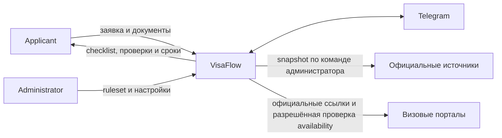
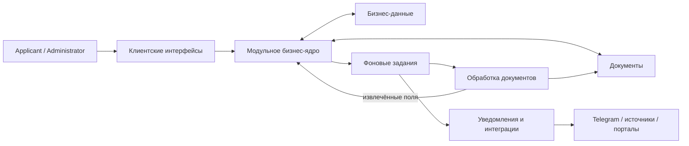

# VisaFlow Architecture

**Статус:** Concept draft 0.1  
**Дата:** 2026-10-11  
**Горизонт:** рабочая pilot-версия к апрелю 2027

## 1. Назначение документа

Документ описывает общую архитектурную идею VisaFlow: границы системы, крупные области ответственности, основные потоки и принципы развития.

На текущем этапе документ **не фиксирует** точный набор deployable-контейнеров, число инстансов, облачного провайдера, сетевую топологию или окончательный выбор инфраструктурных сервисов. Эти решения принимаются после уточнения нагрузки, бюджета, требований к восстановлению и результатов технических экспериментов.

Функциональные требования определены в [SRS](SRS.md), продуктовые границы — в [PRD](PRD.md), а правила организации кода — в [Engineering Guidelines](engineering-guidelines.md).

## 2. Контекст системы

VisaFlow помогает заявителю самостоятельно подготовить туристическую визовую заявку: формирует персональный checklist, проверяет документы, рассчитывает сроки и отправляет уведомления. Пользователь самостоятельно завершает запись на официальном портале.

Версия C1 в PlantUML: [`diagrams/c4-context.puml`](diagrams/c4-context.puml).

VisaFlow не принимает решение о выдаче визы, не оказывает юридическую консультацию, не бронирует слот и не обходит CAPTCHA, авторизацию или другие ограничения внешних систем.

## 3. Архитектурные драйверы

| Драйвер | Влияние на архитектуру |
|---|---|
| Команда из двух разработчиков и ограниченный срок | Архитектура должна оставаться простой в разработке и эксплуатации |
| Pilot с чувствительными документами | Обработка файлов изолируется, доступы минимизируются, окружения разделяются |
| Документы нельзя передавать внешнему AI | OCR и проверки выполняются внутри инфраструктуры VisaFlow |
| Проверка должна быть объяснимой | Результаты формируются детерминированными правилами и связаны с `rule_id`/`source_id` |
| OCR и интеграции могут быть медленными или нестабильными | Долгие операции выполняются асинхронно и не блокируют основной пользовательский сценарий |
| Внешние порталы могут менять структуру или ограничивать запросы | Интеграции изолируются адаптерами и отключаются при небезопасном поведении |
| Правила меняются со временем | Ruleset версионируется; опубликованная версия неизменяема и закрепляется за заявкой |

## 4. Выбранная архитектурная идея

VisaFlow строится как **модульное бизнес-ядро с отдельно изолированной обработкой документов**.

### 4.1 Модульное бизнес-ядро

Основные бизнес-возможности — пользователи, заявки, правила, checklist, сроки, уведомления, администрирование и аудит — развиваются как части одного согласованного ядра.

Такой подход выбран потому, что:

- возможности используют общее транзакционное состояние;
- продукт разрабатывает одна небольшая команда;
- независимые SLA и release cadence для большинства областей пока отсутствуют;
- микросервисное разделение добавило бы сетевые контракты и распределённую согласованность без подтверждённой пользы.

Внутри ядра области разделены явными модульными границами. Общая база данных не означает, что один модуль может напрямую изменять данные другого.

### 4.2 Изолированная обработка документов

Проверка файлов и OCR отделяются от бизнес-ядра как самостоятельная область исполнения, потому что она:

- работает с недоверенными файлами;
- использует Python и специализированные библиотеки;
- имеет отдельный профиль CPU/RAM-нагрузки;
- требует ограниченного сетевого доступа;
- должна масштабироваться и завершаться с ошибкой независимо от основного приложения.

Обработчик документов извлекает и нормализует поля, но не применяет визовые бизнес-правила и не принимает решения за пользователя. Итоговая rule-based проверка остаётся частью бизнес-ядра.

### 4.3 Асинхронные операции

OCR, отправка уведомлений, retention, работа с источниками и разрешённые проверки внешних порталов выполняются в фоне.

Механизм фоновых заданий должен обеспечивать:

- идемпотентность;
- timeout и ограниченный retry;
- фиксацию неуспешного результата;
- отсутствие PII в payload;
- восстановление задания после временного отказа инфраструктуры.

### 4.4 Адаптеры внешних систем

Telegram, object storage, официальные источники и визовые порталы подключаются через адаптеры. Бизнес-правила не зависят от конкретного SDK или провайдера.

Получение официального источника инициирует Administrator. Система сохраняет snapshot/checksum и показывает diff, но не публикует изменения автоматически.

## 5. Логическая схема

Схема показывает области ответственности, а не будущие deployment-контейнеры.

## 6. Логические области ответственности

| Область | Ответственность |
|---|---|
| Клиентские интерфейсы | Сценарии Applicant и Administrator; отображение состояния и результатов |
| Identity и access | Telegram-аутентификация, сессии, роли, ownership и согласия |
| Application | Заявки, основной заявитель, члены семьи и жизненный цикл заявки |
| Rules и checklist | Версии правил, источники, генерация checklist и прогресс |
| Documents | Metadata, безопасная загрузка, подтверждённые поля, проверки и удаление |
| Document processing | Проверка файла, malware scan, OCR и нормализация |
| Deadlines и notifications | Расчёт сроков и доставка Telegram-напоминаний |
| Appointments | Проверенные ссылки, capability model и экспериментальный monitoring |
| Administration и audit | Публикация ruleset, feature flags, health и аудит чувствительных действий |
| Persistence | Бизнес-данные, бинарные документы и состояние фоновых операций |

Это логическое разделение. Одна область не обязательно соответствует отдельному процессу или сервису.

## 7. Ключевые потоки

### 7.1 Создание checklist

1. Applicant проходит серверно проверенную Telegram-аутентификацию.
2. Пользователь создаёт заявку и указывает параметры поездки.
3. Бизнес-ядро выбирает опубликованный ruleset и закрепляет его версию за заявкой.
4. Checklist формируется для заявки и каждого участника.
5. Новая версия ruleset не меняет существующий checklist без явного пересчёта.

### 7.2 Обработка документа

1. Система проверяет владельца заявки и актуальное согласие.
2. Пользователь загружает файл по ограниченной временной ссылке.
3. Файл проходит проверку типа, размера и вредоносного содержимого.
4. Изолированный обработчик выполняет OCR и возвращает поля с confidence и версией распознавателя.
5. Пользователь подтверждает или исправляет распознанные значения.
6. Бизнес-ядро выполняет детерминированные проверки по закреплённому ruleset.
7. Каждый результат содержит уровень, объяснение, `rule_id` и `source_id`.

### 7.3 Обновление правил

1. Administrator указывает официальный источник и инициирует его получение.
2. Система сохраняет snapshot, checksum и дату проверки.
3. Изменение источника формирует diff и draft ruleset.
4. Administrator проверяет изменение и вручную публикует новую версию.
5. Опубликованная версия становится неизменяемой и используется только новыми или явно пересчитанными checklist.

### 7.4 Уведомления и внешние порталы

1. Сроки рассчитываются из заявки и ruleset.
2. Фоновая операция отправляет уведомление через Telegram с защитой от дублей.
3. Для записи система показывает проверенную официальную ссылку.
4. Italy monitoring запускается только при разрешённом источнике, включённом feature flag и исправном адаптере.
5. CAPTCHA, 403/429 или неизвестная структура останавливают дальнейшие проверки.

## 8. Данные

- Бизнес-состояние имеет единый канонический источник.
- Бинарные документы хранятся отдельно от доменных записей.
- Очередь или иной механизм доставки заданий не является источником бизнес-истины.
- Опубликованный ruleset неизменяем, а заявка хранит ссылку на конкретную версию.
- Исходные файлы и производные OCR-данные удаляются по запросу пользователя и согласно retention policy.
- Audit хранит metadata действия, но не содержимое документов и не полный OCR.
- Backup и retention должны быть согласованы: удалённые документы не должны сохраняться бессрочно в резервных копиях.

## 9. Безопасность и приватность

- `development`, `CI`, `demo` и `pilot` разделяются; реальные документы разрешены только в отдельно одобренном pilot-окружении.
- Все внешние соединения используют TLS.
- Доступ к заявке и документу проверяется на уровне конкретного объекта.
- Обработка документов выполняется с минимальными правами и без произвольного outbound-доступа.
- Документы, паспортные поля, исходные имена файлов и полный OCR не попадают в logs, traces, metrics или job payload.
- Секреты не хранятся в исходном коде или container image.
- Чувствительные действия записываются в audit log без PII.
- До допуска реальных документов обязательны threat model, privacy review и restore test.

## 10. Надёжность и деградация

- Отказ OCR не должен блокировать работу с заявкой и checklist.
- Отказ Telegram задерживает уведомления, но не изменяет бизнес-состояние.
- Отказ визового портала не влияет на checklist, документы и обычные напоминания.
- Фоновые операции допускают повторное выполнение без дублирования результата.
- Для временных ошибок применяются timeout, ограниченный retry и backoff.
- Критичные данные резервируются; восстановление проверяется до pilot.
- Производительность и доступность подтверждаются измерениями, а не предполагаются из выбранной технологии.

## 11. Наблюдаемость

Система должна позволять ответить на вопросы:

- доступно ли основное пользовательское API;
- растёт ли очередь фоновых операций;
- сколько времени занимает обработка документа;
- доставляются ли уведомления вовремя;
- исправны ли внешние адаптеры;
- выполняются ли retention и backup;
- какой технический request/job привёл к ошибке.

Telemetry использует технические идентификаторы и агрегаты без PII.

## 12. Направление deployment

Для development и demo достаточно локального окружения с синтетическими данными. Pilot разворачивается отдельно и использует инфраструктуру, подходящую для чувствительных данных и проверенного восстановления.

На текущем этапе зафиксированы только принципы:

- бизнес-ядро и обработка документов могут масштабироваться независимо;
- состояние не хранится только в памяти экземпляра приложения;
- инфраструктура допускает автоматический restart и контролируемый rollout;
- отказ одного необязательного обработчика не должен останавливать основной сценарий;
- Kubernetes не является обязательным условием pilot и вводится только при измеримой потребности.

## 13. Отложенные решения

| Решение | Что нужно узнать до фиксации |
|---|---|
| Точный набор runtime-контейнеров | Границы процессов, эксплуатационные обязанности и частота независимых релизов |
| Число инстансов и схема балансировки | Нагрузочный профиль, бюджет и допустимый downtime |
| Конкретная очередь заданий | Требования к durability, throughput и эксплуатации |
| Конкретные БД и object storage offerings | Провайдер, размещение данных, SLA и стоимость |
| Network topology | Threat model и возможности выбранного провайдера |
| RPO/RTO и backup topology | Допустимая потеря данных и время восстановления |
| Точный retention backup | Требования privacy и срок исчезновения удалённого документа из копий |
| Формат запуска Document Processor | Результаты OCR benchmark и профиль CPU/RAM |
| Периодический source monitoring | Польза для pilot и допустимость автоматических запросов |
| Italy slot monitoring | Результаты technical/legal spike |

## 14. Когда пересматривать архитектуру

Модульную границу имеет смысл выносить в отдельный сервис, когда существует измеримая причина: отдельный SLA, профиль масштабирования, security boundary, release cadence или команда-владелец.

Точную container/deployment-архитектуру следует зафиксировать после:

1. согласования pilot load profile;
2. определения RPO/RTO и бюджета;
3. threat model для документов и административного доступа;
4. OCR benchmark;
5. выбора инфраструктурного провайдера.
